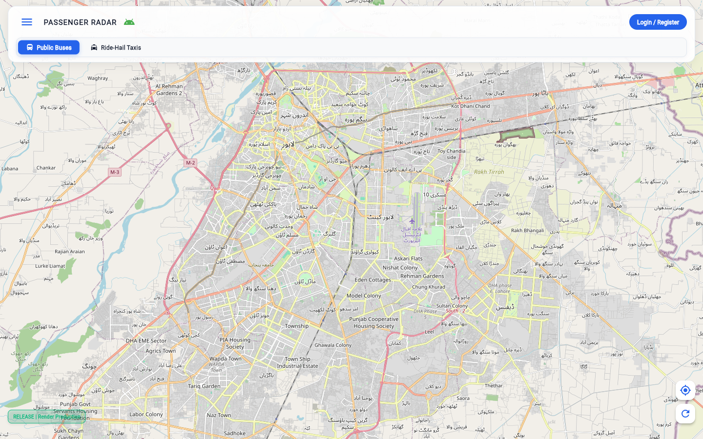
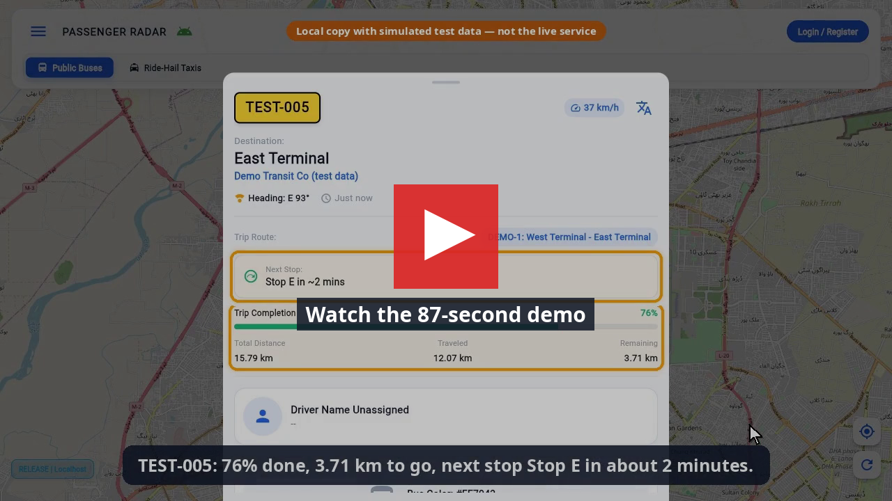
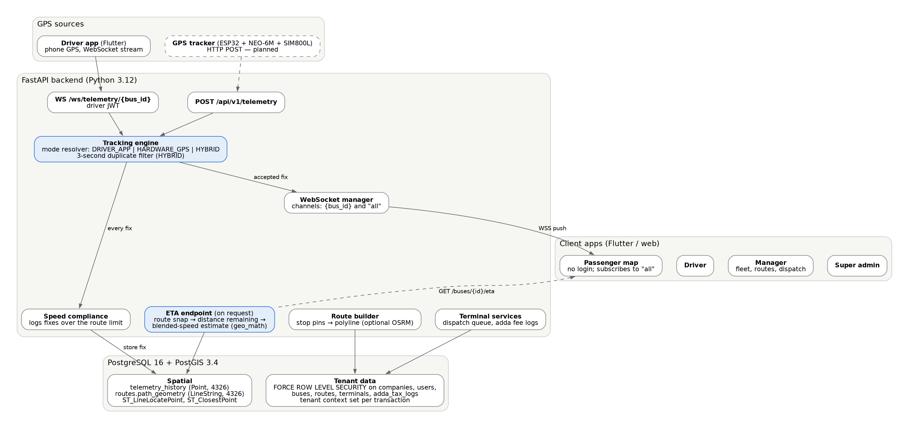
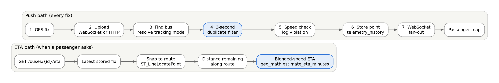
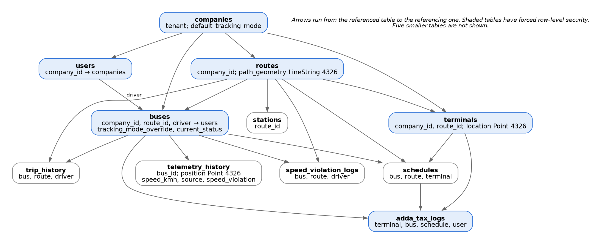

# OpenTransit Radar

**Live tracking and arrival-time estimates for privately operated buses in Lahore.**
Final-year design project, B.S. Computer Science, University of the Punjab (Government Islamia Graduate College). Team of three. **In progress (November 2026 – June 2027).**

> This is a public showcase. The full source code lives in a private repository because it is an assessed team project. This repository contains the architecture, the evaluation plan, screenshots, and one self-contained module with its tests. I am happy to walk through the private code on request.

**Live service:** https://opentransit-randar1.onrender.com. This is the real deployment, not a demo: buses appear only when a registered vehicle is on duty, so the map is often empty during development. The first load can take about a minute on free hosting.


*Passenger Radar on the live service, 20 November 2026, with no vehicle on duty. Map data © OpenStreetMap contributors.*

## Demo video (87 seconds)

[](https://youtu.be/f8fbaKTtuMM)

Seven simulated buses on the Passenger Radar; tapping a bus opens its trip card with live speed, progress along the route, distance left, and the ETA to the next stop. **Recorded on a local copy with simulated test data, not the live service;** bus movement is sped up 6× and every name, plate and company in it is test data.

---

## The problem

Private coasters and wagons carry a large share of Lahore's commuters, but none of their positions are published. Passengers wait without knowing where the bus is, and terminal managers run dispatch queues and fee records by hand. OpenTransit Radar aims to give passengers a no-login live map with arrival estimates, and operators a low-cost fleet and dispatch tool, using either a driver's phone or a small ESP32 GPS tracker.

## What exists today and what is planned

| Component | Status |
|---|---|
| Telemetry ingestion API (FastAPI; HTTP and WebSocket) | Working prototype |
| Route snapping with PostGIS (`ST_LineLocatePoint`) | Working prototype |
| Arrival-time estimator, unit-tested (module in this repo) | Working prototype; not yet measured on real trips |
| Multi-tenant data separation (PostgreSQL row-level security), tested in CI | Working; cross-tenant tests run on every push |
| Mock telemetry simulator | Used for local testing only; never run against the live service |
| Passenger, driver, manager and admin apps (Flutter / web) | Prototype; being rebuilt during the FYP |
| ESP32 + NEO-6M + SIM800L tracker in vehicles | Planned |
| Pilot on one private route; measured accuracy; usability survey | Planned (spring 2027) |

No pilot has run yet. Every number in the evaluation plan below is a **target**, not a result.

## Architecture





Every GPS fix: upload (WebSocket from the driver app with a driver JWT, or HTTP POST) → find the bus and resolve its tracking mode → 3-second duplicate filter → speed check against the route limit → store the point in PostGIS → WebSocket fan-out to the passenger map.
Arrival times are computed when a passenger asks: latest stored fix → PostGIS route snapping → distance remaining along the route → blended-speed estimate (`geo/geo_math.py`). Tenant tables use forced row-level security, with tenant context set per transaction.

**Stack used in this project:** Python, FastAPI, async SQLAlchemy, PostgreSQL 16 + PostGIS, GeoAlchemy2, JWT, WebSockets, Flutter/Dart, Docker Compose, pytest, GitHub Actions; ESP32 firmware in C++ (planned hardware).

## Evaluation plan (fixed before any results)

| Measure | Target | Method |
|---|---|---|
| Route-snapping error | Median ≤ 15 m | Snapped position vs. a reference phone on pilot drives |
| Update latency | 95% of updates ≤ 5 s | Timestamps at device and passenger app |
| Arrival-time error | Mean ≤ 3 min **and** better than a baseline (remaining distance ÷ average route speed) | Predicted vs. actual arrival on pilot trips |
| Tenant isolation | 100% of cross-tenant attempts blocked | Automated tests with two tenants, run in CI |
| Usability | SUS ≥ 68, n ≥ 20 passengers | Questionnaire after pilot use |

All results will be reported here, including targets the system misses.

## Testing and an AI-assisted security review

In November 2026 I delegated a security review of the backend to an AI coding agent (Claude Code). It found row-level-security policies that granted access whenever tenant context was missing, and it reported that it could not run the integration tests in its own environment. Its changes then failed continuous integration twice: first on a test set-up error, then on a real fault that reading the code had not revealed, where a pooled database connection could carry one tenant's context into another tenant's request. The fix applies tenant context per transaction with fail-closed policies. I merged the change only after cross-tenant tests passed against PostGIS in CI.

The agent did the review and wrote the changes; my part was asking for it, reviewing the changes, and deciding to trust CI rather than the agent's report. This episode is the reason I am interested in how developers judge what coding agents claim about their own work.

Recording the demo video surfaced a second bug the existing tests had missed: the bus card's next-stop ETA silently fell back to a fixed distance, because a stored GPS position was passed to PostGIS in a format it rejected and the error was swallowed. The agent traced it, and the fix measures the distance left along the route to the next stop and uses the same estimator as `geo/geo_math.py`. It added regression tests that fail on the old code, and I merged it in the private repository.

## What is in this repository

```
geo/            geo_math.py — dependency-free route-distance and arrival-time arithmetic
tests/          unit tests for geo_math.py
docs/diagrams/  architecture, data flow, database (PNG + Graphviz sources in src/)
docs/screenshots/
.github/workflows/tests.yml — runs the unit tests on every push
```

## Team and my role

| Person | Role |
|---|---|
| Shoaib Javeed | Originator and team lead; backend, geospatial pipeline, testing |
| Muhammad Farhan | Mobile apps |
| Hafiz M. Abdullah | GPS tracker hardware |

Supervisor: Mian Muhammad Abubakr, Department of Computer Science, Government Islamia Graduate College.

**On AI tools:** I used AI coding assistants throughout the prototype. I designed the architecture, the data model and the tenant-isolation approach, and I treat tests and CI, not an assistant's own report, as the evidence that generated code is correct; the security review above is one example.

## Contact

Shoaib Javeed · dev@shoaibjaveed.me · [GitHub](https://github.com/shoaib-javeed-05) · [LinkedIn](https://www.linkedin.com/in/shoaib-javeed05)
